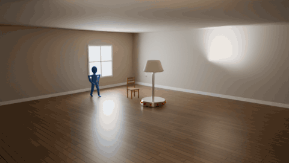

# Learn Blender: Onboarding to Capstone

An 18-session path from "what is this interface?" to a finished short animation, built as
Blender 5.3 project files you can open, inspect, and extend. Every session folder has a
`session-NN-start.blend`, a brief (`README.md`), and check renders.



*The capstone, "The Lamp Keeper" (Session 18): a robot finds a shy creature hiding behind a lamp,
switches the lamp on, and sits down on a wooden chair while the creature settles in the light.
Full-size preview with sound: [`session-18/renders/preview.mp4`](session-18/renders/preview.mp4).*

## The sessions

| # | Session | What you build |
|---|---|---|
| 1 | Onboarding & Interface | A tidy sandbox scene, a customised workspace |
| 2 | Objects & Transforms | A still life from primitives, organised in collections |
| 3 | Modeling I: Edit Mode | A low-poly mug (boolean-hollowed body, fused handle) |
| 4 | Modeling II: Modifiers | A lamp using Bevel, Subsurf, Array, Mirror |
| 5 | Materials & Shading | Metal, plastic and accent materials on the lamp |
| 6 | Lighting | The same lamp lit three ways: studio, dramatic, outdoor |
| 7 | Camera & Composition | Wide, depth-of-field close-up and low-angle cameras |
| 8 | Rendering Engines | Eevee vs Cycles, side by side |
| 9 | UV Unwrapping & Texturing | Seams, checker grid, hand-painted-style texture |
| 10 | Sculpting Basics | A creature head with Multires, ready for brushes |
| 11 | Intro to Animation | A bouncing ball with squash and stretch |
| 12 | Rigging Basics | A character with an IK-legged armature |
| 13 | Animating Rigged Objects | A looping walk cycle |
| 14 | Particles & Physics | Baked rigid bodies and a confetti emitter |
| 15 | Compositing | Glow, colour grade, fringe and vignette node chain |
| 16 | Video Editing (VSE) | Real clips, cross-fades, title and audio on the timeline |
| 17 | Capstone Planning | Storyboard, shot list and asset plan |
| 18 | Capstone | The assembled short: cameras, acting, lighting, sound |

Sessions build on each other: Sessions 4-5 supply the lamp, 10 the creature, 12-13 the
rigged character, 16 the editing setup. The files are *starting points*: the technique work
(sculpt strokes, weight painting, polishing the animation) is meant to be done by hand.

## Layout

```
session-NN/     the .blend, a brief, renders/ (and footage/, audio/ where used)
scripts/        the Python (bpy) that generates every file
docs/           the README animation
```

## Rebuilding everything

Requires Blender 5.3 (macOS path below; adjust for your install). The capstone render uses
Cycles on the GPU (Metal on Apple Silicon) and falls back to CPU if no GPU is found.

```bash
bash scripts/rebuild_all.sh          # regenerates all sessions (~3 min + capstone render)
```

Single session:

```bash
/Applications/Blender.app/Contents/MacOS/Blender --background --python scripts/build_session.py -- 5
/Applications/Blender.app/Contents/MacOS/Blender --background --python scripts/session_18.py -- build
```

`scripts/audio_18.py` synthesises the capstone soundtrack (stdlib only), and
`scripts/make_gif.py` renders the README animation with no external tools.

## Notes

- Blender 5.3 API changes the scripts work around: VSE `strips` (not `sequences`), compositor
  node groups with a Group Output (no Composite node), layered actions (`channelbag`).
- The capstone is a rough blocking pass, not a finished film. The brief for Session 18 lists
  what to replace and polish.
